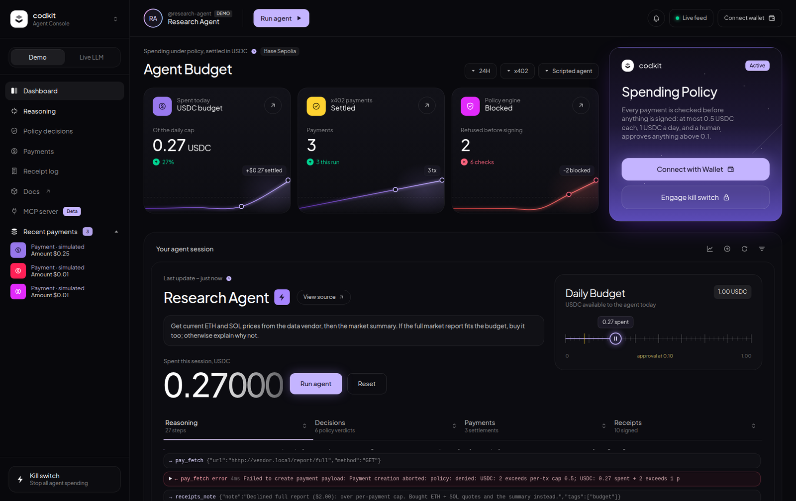

# codkit

Open-source plumbing for Web3 / AI-agent hackathon projects. The kit covers the common pieces so you can spend the weekend on the idea, the sponsor integration, and the demo.



The pattern that keeps winning is an **AI agent that takes a real onchain action, bounded by policy, paid in stablecoins / x402, and leaving verifiable receipts**. This repo provides that skeleton as small, independent modules.

> **Disclosure for submissions:** this kit is a public, MIT-licensed dependency that existed before the event. List it under "dependencies / prior work" so judges can tell your hackathon work from the plumbing.

## Packages

| Package | Status | What it does |
| --- | --- | --- |
| [`@codkit/policy`](packages/policy) | ✅ v0.1 | Guardrail engine: spend caps, allow/deny lists, human approval, mandatory simulation, kill switch. Includes an EVM adapter (viem). |
| [`@codkit/pay`](packages/pay) | ✅ v0.1 | x402 paywall middleware (Hono / Express) and a budget-aware x402 client bounded by `policy`. |
| [`@codkit/contracts`](packages/contracts) | 🟡 EVM + Sui v0.1 | Escrow (create → fund → deliver → release/refund) and reputation in Solidity (Foundry) and Sui Move, with TS bindings. Anchor (Solana) is still to do. |
| [`@codkit/receipts`](packages/receipts) | ✅ v0.1 | Hash-chained, signed action log. Records policy events automatically, anchors onchain (EVM event or calldata, Solana memo, Sui event), stores the full log on Walrus, and lets anyone verify it. |
| [`@codkit/mcp`](packages/mcp) | ✅ v0.1 | Define tools once with Zod and serve them as an MCP server (stdio or HTTP), an agent loop on any OpenAI-compatible LLM (Groq, Gemini, NIM, OpenRouter…), or WebMCP. Includes kit tools for policy, x402, wallet, escrow and receipts. |
| [`@codkit/feed`](packages/feed) | ✅ v0.1 | Live event stream (SSE) of decisions, approvals, tool calls, reasoning, transactions and receipts, plus a human-approval broker. |
| [`apps/demo-shell`](apps/demo-shell) | ✅ v0.1 | Next.js dashboard: wallet connect, live reasoning trace, allowed/blocked decisions, approve/deny, kill switch, transactions with explorer links, and receipt verification. Runs in demo mode with no keys. |
| [`templates/submission`](templates/submission) | ✅ | Submission README template, architecture diagram, 3-minute demo script, checklist, and a deployed-contracts table generator. |

Each package works on its own, and the core of each package imports no chain SDK. Chain and sponsor code lives in thin adapters, because sponsor SDKs change monthly.

## Testnet deployments

Not deployed yet. See [docs/TESTNET.md](docs/TESTNET.md): deploy with your own wallet, run `pnpm e2e:evm` / `pnpm e2e:sui`, and publish the reports here.

| Contract | Network | Address |
| --- | --- | --- |
| _pending_ | Base Sepolia | |
| _pending_ | Sui testnet | |

Ran it yourself? File a [Testnet feedback](https://github.com/deyoungjohn/codkit/issues/new?template=testnet-feedback.yml) issue.

## Develop

```bash
pnpm install
pnpm build       # turbo: builds packages in dependency order
pnpm test
pnpm typecheck
pnpm --filter demo-shell dev   # dashboard at http://localhost:3000 (demo mode, no keys needed)
```

See [TODO.md](TODO.md) for remaining work and tasks that need accounts/funds.

Requirements: Node ≥ 22, pnpm, [Foundry](https://getfoundry.sh), and optionally the [Sui CLI](https://docs.sui.io/guides/developer/getting-started/sui-install) for `contracts`. Clone with `--recurse-submodules`.

## Rules of the repo

- Never commit keys. `.env` is git-ignored, and `.env.example` lists what the examples read.
- Examples use testnet or devnet only. Any deployment or mainnet transaction is run by a human.
- Every package ships with tests and a runnable example.

## License

MIT
