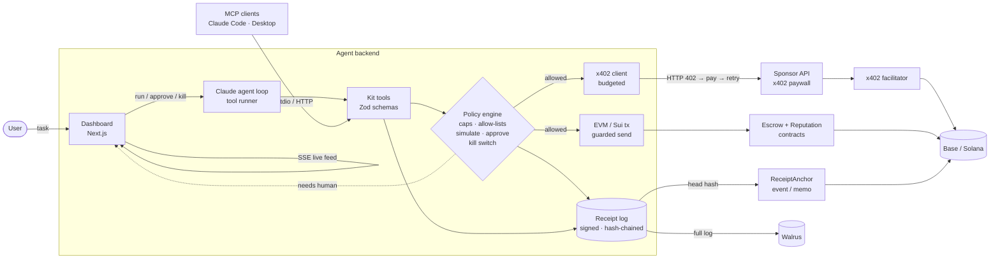

# Architecture

Copy and edit this. Rename the boxes to your product, and delete what you don't use.

## Trust boundaries (judges ask about these)

- **The model never holds keys.** Tools call the policy engine, which signs only allowed actions. Spend is reserved before anything is signed.
- **Simulation runs before every onchain write.** A reverting transaction is never sent.
- **Humans approve anything above the threshold** from the dashboard. Without a response, the request times out and is denied.
- **The kill switch** stops all spending immediately. The agent can engage it itself, but only a human can release it.
- **The receipt log** lets anyone verify what the agent did: check the log on Walrus against the head hash anchored onchain.
